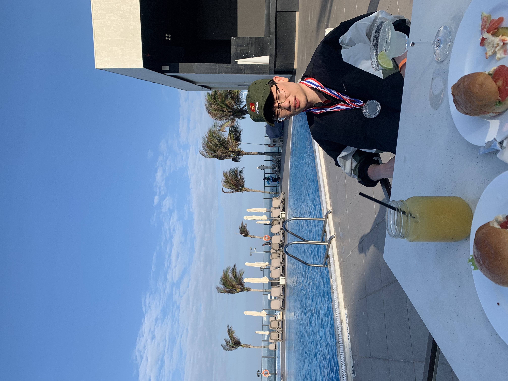
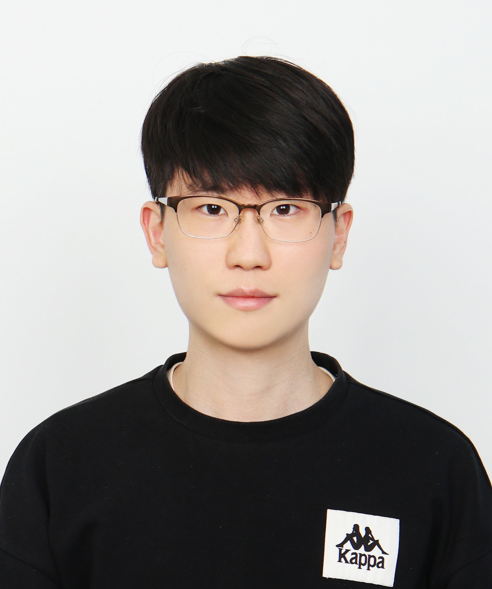
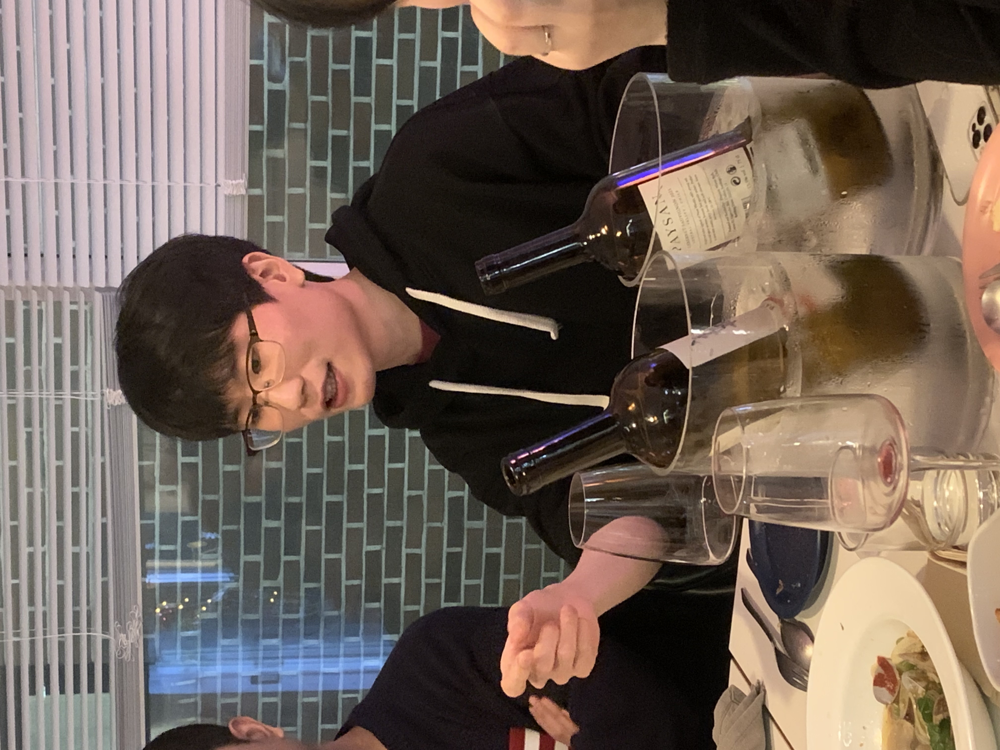
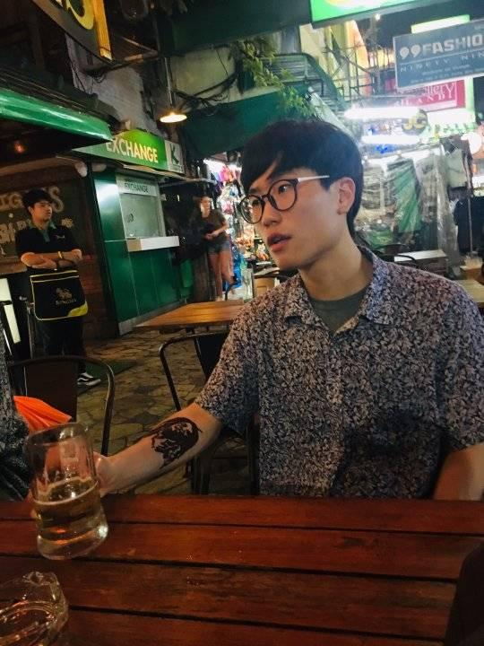
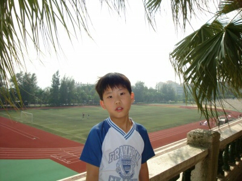
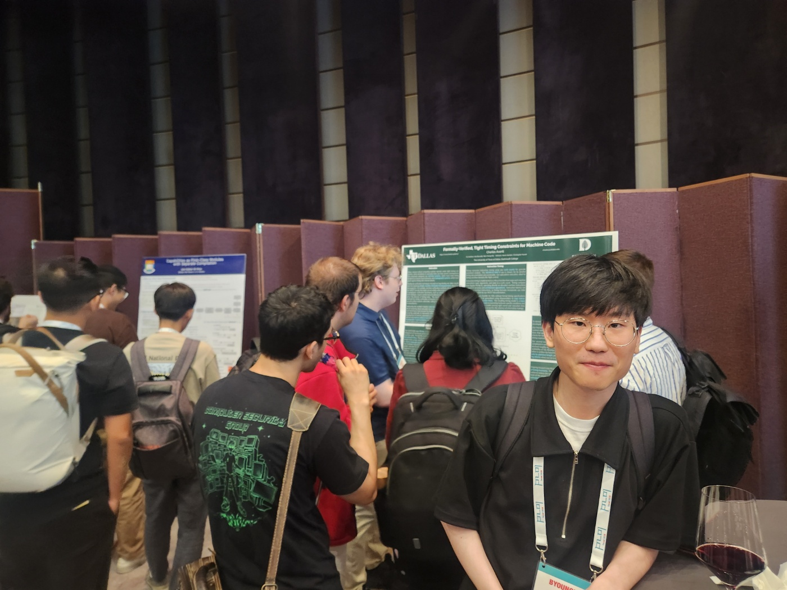

## Personal
* My hometown: [Mapo, Seoul](https://en.wikipedia.org/wiki/Mapo_District).
* How to pronounce my name: just put the 'B' sound in front of 'young'!
* I sometimes enjoy learning human languages: [Duolingo](https://www.duolingo.com/profile/byhoson)
* My first coding experience with >100 loc during high school: [MagicSquare](/asset/magic_square.html/) 

## Personal Top-10 (Unordered)
### [Movies](https://pedia.watcha.com/en-US/users/ld0q02ePgw56X/contents/movies/ratings?type=byStar)
- In the Mood for Love (2000, Wong Kar-wai)
- Vertigo (1958, Alfred Hitchcock)
- Punch Drunk Love (2002, Paul Thomas Anderson)
- Les Parapluies de Cherbourg (1964, Jacques Demy)
- Paris, Texas (1984, Wim Wenders)
- The Florida Project (2017, Sean Baker)
- Inglourioius Basterds (2009, Quentin Tarantino)
- Incendies (2010, Denis Villeneuve)
- Eternal Sunshine of the Spotless Mind (2004, Michel Gondry)
- Le Rayon vert (1986, Eric Rohmer)

### Albums
- Wave (1967, Tom Jobim)
- The Composer of Desafinado, Plays (1963, Tom Jobim)
- Getz/Gilberto (1964, Stan Getz/Joao Gilberto)
- Wish You Were Here (1975, Pink Floyd)
- Kid A (2000, Radiohead)
- The Bends (1995, Radiohead)
- Gruppa Krovi (1988, Kino)
- Nevermind (1991, Nirvana)
- Innerspeaker (2010, Tame Impala)
- Suede (1993, Suede)

### Songs
- Meditação - Tom Jobim
- Triste - Tom Jobim
- Wave - Tom Jobim
- It is not meant to be - Tame Impala
- Pantomime Horse - Suede
- Nude - Radiohead
- All Apologies - Nirvana 
- Shine On You Crazy Diamond - Pink Floyd
- Comfortably Numb - Pink Floyd
- Спокойная ночь - Kino

### Quotes
- "Research is what I am doing when I don't know what I am doing." - Wernher von Braun
- "Don't get any big ideas / They're not gonna happen" - in Nude (In Rainbows), by Radiohead
- "All things are poison, and nothing is without poison; the dosage alone makes it so a thing is not a poison." - Paracelsus
- "The death of childhood is the beginning of poetry." - Tarkovsky
- "A picture is the expression of an impression" - Ernst Hass
- ["Permit yourself to open a book and start reading from anywhere." - Manuel Blum](https://www.cs.cmu.edu/~mblum/research/pdf/grad.html)
- "The literal meaning of life is whatever you're doing that prevents you from killing yourself." - Albert Camus
- "Read, read, read. Read everything—trash, classics, good and bad, and see how they do it." - William Faulkner
- "Remember, kids, the only difference between screwing around and science is writing it down" - Adam Savage
- "Values are; computations do" - P. B. Levy

### Mysterious Connections
- [programming <-> proving](https://en.wikipedia.org/wiki/Curry%E2%80%93Howard_correspondence)
- [secure compilation <-> universal composability](https://dl.acm.org/doi/full/10.1145/3698234)
- [finite automata <-> MSO](https://en.wikipedia.org/wiki/B%C3%BCchi%E2%80%93Elgot%E2%80%93Trakhtenbrot_theorem)
- [complexity classes <-> logical expressivity](https://people.cs.umass.edu/~immerman/descriptiveComplexity.html)
- [computation <-> proof search](https://en.wikipedia.org/wiki/SLD_resolution)
- [turing machines <-> lambda calculus](https://en.wikipedia.org/wiki/Church%E2%80%93Turing_thesis)
- [possible worlds <-> forcing conditions](https://xavierleroy.org/CdF/2018-2019/7.pdf)
- [call by value & name <-> Kleisli & co-Kleisli](https://pblevy.github.io/papers/adjuncttalk.pdf)
- [safety & liveness <-> closed & dense sets](https://www.cs.cornell.edu/fbs/publications/DefLiveness.pdf)
- [syntax & semantics <-> initial algebra & homomorphism](https://en.wikipedia.org/wiki/Algebraic_semantics_%28computer_science%29)

## Some pics
<figure>

</figure>
<figure>

</figure>
<figure>

</figure>
<figure>

</figure>

